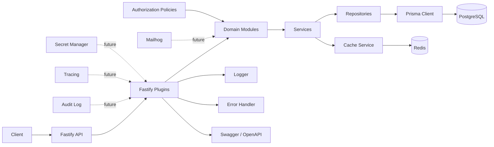
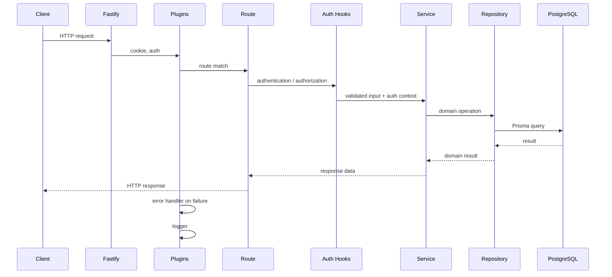
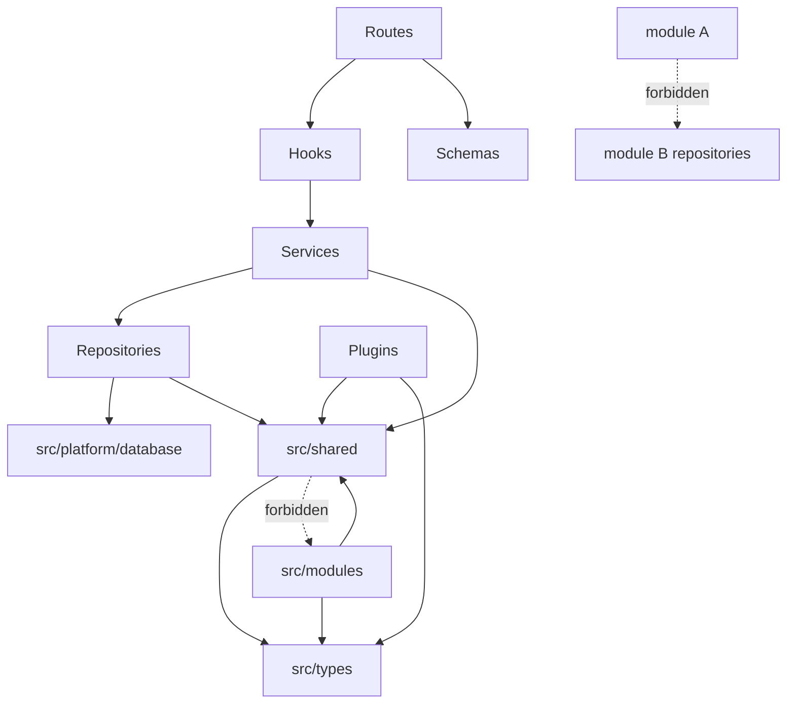

# Oxyide Forge — Architecture

> **Status:** Approved
> **Version:** 1.0
> **Audience:** Senior engineers and maintainers
> **Source of truth:** This document is the single source of truth for the Oxyide Forge architecture.

## Status Legend

- **Current** — present in the starter tree or directly implied by it.
- **Future** — approved extension point; not implemented in the frozen starter.
- **Non-goal / Rejected** — explicitly outside the architecture.

No new runtime technologies beyond the approved stack are introduced by this document.

---

## 1. Product Overview

Oxyide Forge is an open-source Node.js API starter, released under the MIT License, for building secure, modular, production-oriented HTTP APIs.

It provides a baseline architecture for:

- Authentication
- Authorization (RBAC foundation)
- User management
- Health checks
- Database access
- Redis-backed infrastructure
- Centralized error handling
- Logging
- Configuration validation
- API documentation
- Testing

Role data management, Docker-based local development, and advanced security middleware are deferred (§19–§21, §27).

It is a starter, not a finished product. It is intended to be forked, extended, and adapted.

**Current:** The starter is an application template.
**Future:** A dedicated `create-oxyide-api` CLI may be added for npm-based scaffolding.

---

## 2. Architecture Goals

- **Clear module boundaries:** Auth, users, roles, health, and infrastructure must remain separable.
- **Explicit dependency direction:** Domain modules depend on common infrastructure, never the reverse.
- **Secure defaults:** Authentication, cookies, CORS, rate limiting, headers, and configuration must be safe by default.
- **Production readiness:** Logging, error handling, health checks, migrations, and deployment must be operable.
- **Developer experience:** Local setup must be predictable and documented.
- **Upgradeability:** Fastify, Prisma, and infrastructure types must not leak uncontrolled across modules.
- **Testability:** Unit, integration, and contract tests must be possible without fighting the architecture.
- **Operational safety:** Auditability, redaction, secret handling, and authorization must be first-class concerns.
- **Optional infrastructure:** Redis must not be an unconditional hard dependency for every deployment.
- **Scalability:** The API must support horizontal scaling with shared state where required.

---

## 3. Non-Goals

- Not a full identity provider.
- Not a frontend application.
- Not a microservices platform.
- Not a Kubernetes operator.
- Not a message-queue-based system.
- Not a serverless-first runtime.
- Not a full policy engine in the current implementation.
- Not multi-tenant by default.
- Not an npm library in the current implementation.
- Not a CMS or business-domain application.

---

## 4. Technology Stack

| Layer | Current | Future / Approved Extension |
|---|---|---|
| Runtime | Node.js | No change |
| Language | TypeScript | No change |
| HTTP framework | Fastify | No change |
| ORM | Prisma | No change |
| Database | PostgreSQL | Expand/contract migrations, rollback strategy |
| Cache / shared state | Redis client, cache service | Optional adapter, sessions, distributed rate limiting |
| Auth | Auth module, JWT access tokens, cookie plugin, bcrypt password hashing, login throttling (PostgreSQL fixed-window), brute-force backoff (bounded exponential delay), temporary account lockout (`User.lockedUntil`, 30-minute non-extending), security notifications (best-effort post-commit lockout/reset emails, provider-neutral port), authentication email delivery through the transport boundary (: port → adapter → `EmailProvider` → NoOp/SMTP) | CSRF, MFA, suspicious-login detection, breached-password checks |
| Authorization | Permission constants, static roles with role-to-permission mapping, authorization service, guards, policies | Multi-roles (UserRoles), role/permission administration CRUD, permission caching, authorization audit logging |
| API docs | OpenAPI 3.1 document generated from route schemas (`src/plugins/swagger.plugin.ts`), Swagger UI presentation bundle at `/docs`, both independently configurable | Dedicated OpenAPI contract test suite |
| API lifecycle | URL-only major versioning (`/api/v1`), explicit compatibility/breaking classification, route-owned deprecation metadata with OpenAPI + standard-header signalling | Second major version (`/api/v2`) only via an explicit breaking-change decision |
| Validation | Schemas per module | No change |
| Logging | Centralized Pino pipeline: sanitized serializers, non-disableable redaction, single factory for app + startup loggers | Request context propagation, separate audit log, tracing |
| Testing | Vitest config, colocated tests under `src/` | Testcontainers, factories, contract tests |
| Linting / formatting | ESLint, Prettier | Automated architecture checks (§28) |
| Containers | Dockerfile + Compose verification stack | Two-stage image, non-root, no added packages, `HEALTHCHECK` on `/health/ready`, `npm run verify:deployment`; dev/prod profiles and image scanning remain future |
| CI/CD | GitHub Actions CI (PR + main) + tag-gated release pipeline: CI runs every gate with a live PostgreSQL service; releases re-run all gates plus packaging, SBOM, artifact validation, and GitHub Release publication | Image scanning, dev/prod Compose profiles, deployment automation |
| Email delivery | ** (frozen).** Generic SMTP transport over any user-managed server, wired to the three authentication mailer ports, plain `APP_BASE_URL`-derived sender, typed HTML + plain-text templates for verification, password reset, and security notices; NoOp transport when SMTP is unconfigured | Mailhog dev-only profile; templates for non-authentication flows; durable delivery, tracking, bounces, localization, branding (out of V1) |
| Secrets | `.env.example` | Secret manager integration |
| Release/versioning | Not frozen | Changesets or semantic-release if npm distribution is approved |

---

## 5. High-Level Architecture



**Current:** Fastify API with plugins, domain modules, services, repositories, Prisma, PostgreSQL, Redis client, logger, error handler, and authorization policies.
**Future:** Audit log, tracing, secret manager integration, and optional Redis-backed session/rate-limit storage.

---

## 6. Request Lifecycle



**Current:** Security plugins, route hooks, authentication, authorization, service layer, repository layer, Prisma, and error handler.
**Future:** CSRF validation for cookie auth, distributed rate limiting, and trace propagation.

---

## 7. Folder Structure

```text
oxyide-forge/
├── docs/
│ ├── architecture.md
│ ├── engineering-standards.md
│ ├── api-conventions.md
│ ├── auth.md
│ ├── authorization.md
│ ├── deployment.md
│ ├── development.md
│ ├── migrations.md
│ └── adr/ # 001, 002, 003, 005, 006, 007, 008, 009, 010,
│ # 011, 012, 013, 014 (004 never issued)
├── prisma/
│ ├── schema.prisma
│ ├── seed.ts # Explicit idempotent seed entry point
│ ├── seed.integration.test.ts # Seed behavior tests
│ └── migrations/ # 10 additive migrations (deployment source of truth)
├── scripts/
│ ├── architecture-check.cjs # 16 machine-checked boundary rules (see §28)
│ ├── architecture-check.test.ts
│ ├── security-scan.cjs /.test.ts
│ ├── release-validate.cjs
│ ├── sbom-validate.cjs
│ ├── verify-deployment.cjs
│ ├── db-backup.cjs /.integration.test.ts
│ ├── developer-commands.test.ts # Documented-command drift guard
│ ├── package.sh / package.ps1 # Release packaging (release workflow only)
├── src/
│ ├── main.ts
│ ├── app/
│ │ ├── app.ts # Fastify factory: plugins, error handler, routes
│ │ ├── server.ts # Listener lifecycle (SIGINT/SIGTERM)
│ │ ├── routes.ts # Module route registration (one line per module)
│ │ └── lifecycle.ts
│ ├── config/
│ │ ├── index.ts # Sole production process.env reader
│ │ ├── env.schema.ts # Zod validation authority
│ │ ├── types.ts
│ │ └── index.test.ts / env-example-consistency.test.ts
│ ├── modules/
│ │ ├── auth/
│ │ │ ├── routes/auth.routes.ts
│ │ │ ├── services/ # auth, credential, password, token, session, …
│ │ │ ├── repositories/ # credential, session, password-reset, …
│ │ │ ├── email/ # auth email adapters + composition
│ │ │ └── *.types.ts # credential, session, password-reset, …
│ │ ├── authorization/ # permissions, policies, guards, roles, service
│ │ ├── users/ # routes/, users.service.ts, user.repository.ts,
│ │ │ # user-response.ts, user.types.ts
│ │ ├── roles/ # routes/ + index.ts (read-only in V1)
│ │ ├── notes/ # Canonical reference module: routes/,
│ │ │ # notes.service.ts, note.repository.ts,
│ │ │ # note-response.ts, note.types.ts
│ │ └── health/ # health.route.ts (liveness + readiness)
│ ├── platform/
│ │ ├── database/prisma.ts # The single Prisma client
│ │ ├── cache/ # redis.ts, cache.service.ts (optional)
│ │ └── email/ # SMTP transport (sole nodemailer importer)
│ ├── plugins/ # auth, cookie, cors, redis, request-id,
│ │ # security-headers, swagger, telemetry
│ ├── shared/
│ │ ├── errors/ # app-error.ts, error-codes.ts, error-mapper.ts
│ │ ├── email/ # provider contract + templates/
│ │ ├── pagination|sorting|filtering/ # Validated list-query primitives
│ │ ├── logging|tracing|metrics/ # Pipeline options, NoOp tracer/metrics
│ │ └── api-lifecycle/ # Deprecation metadata handling
│ └── types/ # auth-context.ts, fastify.d.ts, shutdown-phase.ts
├──.distignore
├──.env.example
├──.gitignore
├── AGENTS.md
├── CHANGELOG.md
├── LICENSE.txt
├── README.md
├── eslint.config.js
├── package.json
├── package-lock.json
├── tsconfig.json
└── vitest.config.ts
```

Test files are colocated with their sources (`src/**/*.test.ts` for unit tests, `src/**/*.integration.test.ts` for PostgreSQL integration tests); there is no separate `tests/` directory.

**Current:** The tree above is the actual starter tree.
**Placeholder policy (ruling):** Every source file in the tree exists as real code or a real contract. Empty source placeholders are forbidden (AGENTS.md hard rule 8; engineering standards §31.6). Future capabilities — for example email, sessions, MFA, rate limiting, CORS, OpenAPI/Swagger, telemetry, seed scripts, Docker, and CI/CD — are declared only as **Future** in this document and receive files, contracts, and directories when their implementation milestone starts. Structural or tooling files are retained only with a concrete, verifiable reason.
**Legacy note:** Earlier drafts referred to `src/common`, `src/db`, `src/cache`, `src/logging`, and `src/docs`; these are historical layout names and are not part of the final architecture. Their concepts map to `src/shared`, `src/platform/database`, `src/platform/cache`, and plugin-based OpenAPI responsibilities. `health.schemas.ts` should be removed unless contract-bound. Authorization policies, audit logging, and email service abstractions are added under approved extension points (email boundary: `src/shared/email/` contract, `src/platform/email/` transport, `src/modules/auth/email/` authentication adapters and composition).

---

## 8. Module Boundaries

| Module | Owns | Does Not Own |
|---|---|---|
| `auth` | Credentials, JWT access tokens, auth schemas, auth services, auth repository, **email adapters and composition** (`email/`: domain-mailer-to-template-data translation, sender derivation, single NoOp/SMTP selection point) | User profile, roles, sessions, refresh tokens, authorization policies, transport concerns, **markup and copy** |
| `authorization` | Permission constants, static role definitions, `requireAuth`/`requirePermission`/`requireRole` guards, owner/self-scope policies (`userPolicy`, `notePolicy`), authorization service + decision audit events | Persistence, business workflows, Prisma |
| `users` | Identity, profile, user CRUD, user schemas, user repository | Credentials, tokens, authorization policies |
| `roles` | Role listing and detail (read-only in V1); Future: role and permission data administration | Authorization enforcement |
| `notes` | Canonical reference module: user-owned CRUD demonstrating routes → service → repository layering, owner-only `notePolicy`, single public mapper, –list primitives | Any product domain (copy the structure, not the feature) |
| `health` | Liveness and readiness | Domain logic |
| `shared` | Errors (`app-error.ts`, `error-codes.ts`); email transport boundary (`email/email-message.ts`, `email/email-provider.ts`: message contract, provider interface, neutral error, NoOp default); **email template system** (`email/templates/`: closed template registry, typed per-template data, shared layout, HTML escaping) | Any domain module; persistence, HTTP, transport, configuration |
| `platform/email` | SMTP transport implementing the shared `EmailProvider` interface (`smtp-email-provider.ts`: disposable per-send transport, single attempt, static-safe error translation) + centralized NoOp/SMTP selection | Domain logic, **message content and templates**, retry policy |
| `types` | Fastify type augmentation and neutral cross-layer contracts (e.g. `AuthContext`) | Domain logic and module implementation details |
| `platform/database` | Prisma client, transaction helper, database infrastructure | Module-specific queries |
| `platform/cache` | Redis client, cache service | Domain cache ownership |
| `plugins` | Cross-cutting Fastify concerns | Domain logic |

**Current:** Boundaries are convention-based and machine-checked by `npm run architecture:check` (see §28). Modules must not import each other's repositories.

### 8.1 Email Boundary (FROZEN 2026-10-06)

Four layers, one direction, each with a single owner:

```
modules/auth/services domain mailer ports (caller-side contracts: what auth needs)
 │ { to, resetUrl } | { to, verificationUrl } | { to, lockoutDurationText } | { to }
 ▼
modules/auth/email adapters + composition ── the ONLY place a transport is selected
 │ typed template data
 ▼
shared/email/templates registry + templates + shared layout + escaping ── the ONLY owner of copy and markup
 │ { subject, text, html }
 ▼
shared/email message contract + EmailProvider + EmailDeliveryError + NoOp (frozen)
 │
 ▼
platform/email SMTP transport + NoOp/SMTP factory ── the ONLY importer of nodemailer
```

Rules that future work must preserve:

- Authentication never learns a transport exists. `if SMTP…`, provider selection, host, port, credentials, and TLS mode appear nowhere below `src/modules/auth/routes/`.
- The adapters translate only. They never generate, hash, store, log, or inspect credentials; never touch Prisma, repositories, or Fastify request objects; never catch a delivery failure (each port's caller owns its frozen failure semantics).
- Composition is one module and one decision: SMTP configured → SMTP transport, otherwise the frozen NoOp ports verbatim. Startup never depends on a live mail server — the SMTP transport opens its connection on first send.
- The sender is derived from validated `APP_BASE_URL` (`no-reply@<host>`). There is no `SMTP_FROM` and no per-message default; a second sender source would be dead configuration.
- One `send` is one delivery attempt. No retry, queue, outbox, worker, or durable delivery exists (deferred).
- **Copy and markup live only in `shared/email/templates`**. No module contains subject strings or HTML; a service passes facts (a finished one-time URL, a policy-derived duration, an event kind) and never rendered content.

### 8.2 Email Template System

A template is a **pure function of typed data**: `data → { subject, text, html }`. No I/O, no configuration, no environment, no clock, no randomness, no request context, no transport knowledge — enforced by **ARCH-ENF-016** (`Email template purity`), scoped to `src/shared/email/templates`.

- **Registry.** `EMAIL_TEMPLATE_KEYS` is a closed `const` tuple; `EMAIL_TEMPLATES` is a total record typed over it, so a key without a renderer — or a renderer without a key — does not compile. `renderEmailTemplate(key, data)` is the single dispatch, generic over the key so each template accepts only its own data contract. An unknown key throws; so does an unknown security-notification kind (falling through to another notice would tell a customer the wrong thing about their account).
- **Inventory.** `EMAIL_VERIFICATION`, `PASSWORD_RESET`, `SECURITY_NOTIFICATION` — exactly the three authentication flows. A new template is two edits: the key tuple and its renderer.
- **Data contracts** are per-template and minimal: a finished one-time URL for the two credential emails; `{ type }` plus `lockoutDurationText` for notices. Nothing else is accepted, so a future domain-model change cannot widen what a template can see. Passwords, token hashes, session/refresh tokens, JWTs, cookies, `User` rows, Prisma models, `AuthContext`, and internal identifiers have no field to travel in.
- **URLs are supplied, never constructed.** The template receives the finished URL and never learns the base URL, the token, or its lifetime — that belongs to the application layer.
- **Escaping.** Every dynamic value passes through one deterministic escaper (`& < > " '`, ampersand first, single pass). Only the layout renders markup, so escaping has exactly one implementation. HTML is table-based, inline-styled, colour-free (Forge defines no brand palette), and contains no script, iframe, form, image, tracking pixel, web font, or remote resource.
- **Text is a first-class output**, rendered from the same content model as the HTML — never derived by stripping tags — so the two cannot drift and no markup leaks into the plain-text form.
- **Adding a template:** extend `EMAIL_TEMPLATE_KEYS`, add a renderer to `email-templates.ts`, add tests, and map the domain request in `modules/auth/email/auth-email-mailers.ts`. Nothing else changes; authentication, the ports, and the transport are untouched.

### 8.3 Email Ownership Model (FROZEN)

Who owns what, stated once so no future change has to infer it:

| Layer | Owns | Must never own |
|---|---|---|
| **Authentication** (`modules/auth/services`) | Business facts and *when* an email is requested: token generation, hashing, expiry, transactions, policy-derived values (e.g. lockout duration), the canonical recipient | Subject lines, wording, HTML, SMTP settings, provider choice, transport errors |
| **Auth email adapter** (`modules/auth/email`) | Conversion of a domain request into typed template data, and of rendered content into `EmailMessage`; the single NoOp/SMTP selection point; sender derivation from `APP_BASE_URL` | Copy, markup, escaping, SMTP options, retries |
| **Templates** (`shared/email/templates`) | Subject and body presentation: the closed key vocabulary, per-template data contracts, HTML layout, HTML escaping, plain-text rendering | Anything but rendering: no I/O, config, clock, randomness, request context, database, or transport |
| **Shared email contract** (`shared/email`) | The transport-neutral `EmailMessage` shape, the `EmailProvider` interface, the neutral `EmailDeliveryError`, and the NoOp provider | SMTP, HTML, domain knowledge |
| **SMTP platform** (`platform/email`) | The actual SMTP transport: connection options, TLS/security modes, timeouts, single-attempt delivery, error translation | Templates, copy, domain knowledge |

**Frozen behaviour at a glance.** Delivery is post-commit everywhere; one `send` is exactly one attempt with no retry, queue, or outbox; a delivery failure after commit never rolls back committed authentication state (it surfaces as the sanitized `500`, or is caught and logged for security notices, which never alter an authentication outcome); unconfigured SMTP keeps the frozen NoOp ports so no deployment must configure mail; and a one-time URL appears in the message body only — never in a subject, header, log, event, error, or metric.

**is frozen** . Reopening requires a concrete security/correctness defect, a compatibility requirement, or an explicit project requirement, and must name the affected contract, add regression coverage, and update the documentation. Explicitly out of scope: queues, workers, outbox, retries, provider expansion, email history, delivery/open/click tracking, bounces, complaints, analytics, marketing, localization, a template CMS, and custom branding.

---

## 9. Dependency Direction



**Current:** Dependency direction is convention-based and machine-checked by `npm run architecture:check` (see §28): `modules -> shared/platform/types`, never the reverse. Direct module-to-module repository imports are forbidden. Services own cross-module orchestration through contracts.

---

## 10. Database Architecture

**Current:**
- PostgreSQL is the primary database.
- Prisma is the ORM.
- `prisma/schema.prisma` contains the Prisma datasource and generator configuration.
- `prisma/migrations/` contains the committed migrations; the migration operating procedure is `docs/migrations.md`.
- Production applies `npx prisma migrate deploy` and requires a clean `npx prisma migrate status` before application start (proven lifecycle; procedure in `docs/migrations.md`).
- `src/platform/database/prisma.ts` owns Prisma client construction and lifecycle only.
- Connection behavior is configured through `DATABASE_URL` query parameters (native Prisma mechanism; no parallel variables): `connection_limit`, `pool_timeout`, and `connect_timeout` must be positive integers (≥ 1) when present; `sslmode` must be `require` or `disable`. Values are validated at startup; production requires `sslmode=require`.
- `prisma/seed.ts` is the explicit idempotent seed entry point (`npm run db:seed`); the current schema defines no baseline seed data, so it inserts nothing.
- Each module has its own repository.

**Transactions:**
- The service/use-case layer owns business transaction boundaries. Services open transactions with `prisma.$transaction`; repositories never open their own transactions (engineering standards §16.1).
- Repositories own query/mutation execution and accept an optional transaction client (`tx?: Prisma.TransactionClient`), using it for their operation when provided.
- All persistence operations that must be atomic for one business operation use the same transaction client, threaded explicitly across module service boundaries:

 ```text
 Users service
 |
 | owns transaction
 v
 tx
 |
 +---- Users repository
 |
 +---- Auth credential service (public contract)
 |
 +---- Auth credential repository (same tx)
 ```

- There are no nested transactions: a service called inside a transaction receives the transaction client instead of opening a new one.
- Transaction clients are passed explicitly per operation and are never stored on services, singletons, or globals.
- Unexpected database errors inside a transaction propagate to the owning service so the transaction rolls back; only the documented not-found outcome (Prisma `P2025`) is converted to a `false`/`null` result.
- Transactions contain database work only — no external I/O (engineering standards §16.2). Expensive non-database work such as password hashing happens before the transaction opens.
- Transactions run with PostgreSQL `READ COMMITTED` and Prisma default isolation; pool and establishment timeouts are configurable per-instance through validated `DATABASE_URL` parameters (see `docs/deployment.md`), so transactions never wait on unbounded infrastructure.

**Legacy note:** Older drafts referenced `src/db/*`; those references are historical only and map to `src/platform/database/*` in the final architecture.

**Future:**
- `src/plugins/prisma.plugin.ts` and Prisma application plugin lifecycle integration.
- Introduce an explicit unit-of-work or transaction context.
- Add domain models to `prisma/schema.prisma` when the current domain data model is approved.
- Add reference-data seed operations to `prisma/seed.ts` when the schema gains reference data (mechanism exists; see §10 Current).
- Separate migration jobs from application deployment.
- Use expand/contract migrations with backup and rollback procedures.
- Add audit columns, soft-delete policy, versioning, and optional tenant scoping.
- Keep seeds idempotent and limited to reference data.
- Use factories for tests instead of relying on production seeds.

---

## 11. Redis Architecture

**Current:**
- `src/platform/cache/redis.ts` provides Redis connectivity.
- `src/platform/cache/cache.service.ts` provides cache operations.

**Legacy note:** Earlier references to `src/cache/*` were renamed to `src/platform/cache/*` in the final architecture.

**Future:**
- Put cache access behind adapters for alternative backends.
- Use Redis for sessions, refresh tokens, and distributed rate limiting.
- Define typed cache keys, TTL policies, versioned namespaces, and invalidation ownership.
- Define outage behavior:
 - Sessions: fail closed.
 - Cache: fail open.
 - Auth rate limiting: fail closed (implemented in with PostgreSQL, not Redis).
- Add Redis to local development profiles if required.

---

## 12. Authentication Architecture

**Current:**
- `src/modules/auth` contains routes, services, repositories, and types; route validation schemas (`FastifySchema`) are defined alongside their routes.
- `src/plugins/cookie.plugin.ts` supports cookie handling.
- Access tokens are JWTs signed with HS256 using required validated configuration variable `JWT_SECRET`.
- Access-token TTL is 15 minutes (900 seconds).
- Passwords are hashed with bcrypt using cost/work factor 12.
- Passwords are never logged, and `passwordHash` never leaves the authentication boundary.
- The current models are `User`, `Credential`, `Session`, `RefreshToken`, `PasswordResetToken`, `EmailVerificationToken`, and `LoginThrottle` (see `docs/auth.md` §3). `User` to `Credential` is one-to-one; `User` to `Session` to `RefreshToken` is one-to-many chains.
- `@fastify/jwt` is the single approved JWT implementation. The authentication plugin owns its registration and configuration. Token service operations must use the application's configured JWT implementation and not introduce independent JWT libraries.
- Successful authentication populates the request `auth` context with the verified access-token claims: `{ sub: string; iat: number; exp: number; }`. This context must not include roles, permissions, scopes, session IDs, or refresh-token information; loading user entities is a separate domain operation.
- Current authentication endpoints are `POST /api/v1/auth/register`, `POST /api/v1/auth/login`, `POST /api/v1/auth/logout`, `GET /api/v1/auth/me`, `POST /api/v1/auth/refresh`, `POST /api/v1/auth/password-reset/request`, `POST /api/v1/auth/password-reset/confirm`, `POST /api/v1/auth/email-verification/resend`, `POST /api/v1/auth/email-verification/confirm`, and `POST /api/v1/auth/sessions/revoke-all`.
- Login throttling uses PostgreSQL-backed fixed-window counters (`LoginThrottle` table) with account and source dimensions. Brute-force protection adds bounded exponential backoff derived from the same account failure state — no new table, no Redis required. Temporary account lockout stores a bounded, non-extending marker on `User.lockedUntil` set by an atomic increment-and-lock transition — no Redis, no background worker, no unlock endpoint. Security notifications send best-effort post-commit emails for the lock transition and successful password resets through a provider-neutral `SecurityNotificationMailer` port — no new table, queue, worker, or endpoint.
- Browser clients use the server-set `accessToken` cookie. Non-browser clients receive the access token in the login response and send it with `Authorization: Bearer`.
- A request must not use both cookie and bearer authentication mechanisms.
- Logout clears the access-token cookie. Stateless bearer access tokens are not revoked in this milestone.
- Cookie authentication is available in development/testing. Production cookie-based authentication must not be enabled until the future CSRF milestone is implemented. In production the cookie plugin is skipped and Bearer authentication remains the supported mechanism.
- Approved authentication dependencies are `@fastify/jwt`, `@fastify/cookie`, and `bcrypt` only.
- Shared security primitives live under `src/shared`.
- `AuthContext` is a neutral cross-layer contract owned by `src/types/auth-context.ts` (ADR-001), not an auth-module implementation detail.

**Legacy note:** Older documentation described auth/security helpers under `src/common`; those references map to the final `src/shared` and `src/platform` layout.

**Future:**
- Add CSRF protection for cookie-based authentication; production cookie authentication remains disabled until this is implemented.
- Production provider delivery for verification, reset, and security-notice emails, plus durable notification delivery (outbox, worker, retry).
- Add MFA, breached-password checks, and suspicious-login detection. (Temporary account lockout is current since; lockout administration stays future.)
- Add general rate limiting (login throttling implemented in with PostgreSQL).

---

## 13. Authorization Architecture

**Current:**
- Auth hooks attach authentication context.
- Authentication provides `AuthContext` (`sub`, `iat`, `exp`).
- Authorization foundation: permission constants, role definitions, role→permission mapping, authorization service, guards (`requireAuth`, `requirePermission`, `requireRole`), and policies.
- Two built-in roles: `user` (default) and `admin`.
- User model includes `role` field (String, default `'user'`).
- Authorization decisions derive from server-side role lookup, never from client data.

**Future:**
- Multiple roles per user (UserRoles join table).
- Role administration CRUD API.
- Permission caching in Redis.
- Audit logging of authorization decisions.

---

## 14. Error Handling Architecture

**Current:**
- `src/shared/errors/app-error.ts` — domain error class with `code`, `statusCode`, `title`, and `detail` (`title`/`detail` default to the safe message; HTTP-adjacent throwers may override either to preserve established bodies — services never do).
- `src/shared/errors/error-codes.ts` — namespaced error code constants.
- `src/shared/errors/error-mapper.ts` — the SOLE classification/translation boundary: `mapError` (AppError → canonical model incl. auth-401 headers; Prisma known codes and Fastify `code`s → approved representations; unknown → sanitized internal) and `sendMappedError` (the single public-body construction site, called only by the global handler). Never imports Fastify runtime values; never logs; never sends except through the handler.
- `src/app/app.ts` (`registerGlobalErrorHandler`) — routes mapped errors (log unexpected, send). Route/guard/plugin code throws; it never constructs envelopes (ARCH-ENF-015).
- API errors use the canonical Problem Details contract (`application/problem+json`, exactly `{type,title,status,detail,code,instance}` — normative in `docs/error-handling.md`,; Prisma/Fastify mapping matrices added).
- `src/app/app.ts` (`registerGlobalErrorHandler`) — a minimal Fastify `setErrorHandler` V1 security control. It preserves the existing `AppError`/4xx behavior and sanitizes unexpected server errors (`statusCode >= 500`) into the generic `INTERNAL_ERROR` body, logging the full error server-side only. This is a security boundary, NOT the deferred centralized error mapper. See `docs/adr/005-global-error-handler.md`.
- Public serialization is a hard trust boundary: the mapper validates an `AppError`'s public fields before publishing them (registered `ErrorCodes` value, integer status 400–599, non-empty string `title`/`detail`; otherwise it fails closed to `INTERNAL_ERROR`), classifies without ever throwing, and assembles the body field by field from validated primitives — no spread, clone, or stringify of a thrown value. The global handler guards classification and send so no failure can hand the response back to Fastify's native serializer. Authorization denials publish the centralized `AUTH_FORBIDDEN_DETAIL` constant; denial reasons stay operator-side. Normative in `docs/error-handling.md`.
- `src/shared/logging/logger-options.ts` (`serializeError`) — the operator-side counterpart, deliberately separate from the wire: non-`Error` throws are reduced to a fixed marker so the redaction walk cannot raise inside the error handler.

**Future:**
- Implement error handler plugin for consistent HTTP error mapping.
- Add shared response helpers and request-context/ID primitives.
- Replace the central error-code registry with module-namespaced error codes.
- Add error tracking and grouping.
- Keep success responses resource-oriented and avoid unnecessary custom envelopes.

---

## 15. Logging Architecture

**Current:**
- One canonical Pino pipeline: `src/shared/logging/` owns serializers, redaction paths, and the `createLoggerOptions` factory consumed by BOTH `src/app/app.ts` (application pipeline) and `src/main.ts` (startup fallback). Redaction is compiled in — never env-tunable, never disableable.
- Request logs carry method, path-without-query, source IP, status code, duration, and request ID only: no headers, no cookies, no bodies, no query strings, no user-agent.
- Request correlation: one authoritative server-generated request ID — emitted as the `X-Request-ID` response header on every in-pipeline response (`request-id.plugin.ts`), referenced by Problem Details `instance` (`/requests/<id>`), and bound as log `reqId`. Client-supplied IDs are never accepted; the three always agree (triangulated by tests).
- Error logs carry type/message/stack/code allowlist only (closed structurally): arbitrary enumerable error props are dropped.
- Framework 404s use a custom handler with a generic message (default handler echoed the full URL incl. query into body AND logs).
- Fastify's built-in Pino logger, configured in `src/app/app.ts`.
- `src/main.ts` constructs a Pino fallback logger for startup failures.
- `request.log` provides request-scoped child loggers (engineering standards §13.5).
- PII policy (proven by `src/app/redaction-privacy.integration.test.ts` on emitted output): email/display-name/user-agent omitted everywhere (bodies, query, headers, security events); socket IP retained in request lines for abuse investigation; user UUIDs retained ONLY as the addressed request path or inside allowlisted security-decision fields (`subjectId`/`targetId`), never in bodies, headers, error metadata, or free text — and deliberately NOT in `REDACT_PATHS` (pinned by test). Query values always stripped. Secret vocabulary (`password`, `passwordHash`, `accessToken`, `refreshToken`, reset/verification tokens, `tokenHash`, `jwtSecret`/`DATABASE_URL`/`redisUrl` + env-case variants, `authorization`/`cookie`/`bearer`/`apiKey`/session/`credentials`) censored at every nesting depth when it reaches a logged object; serializers omit whole categories (headers, cookies, bodies, query) so these keys normally have no path to logs at all. No speculative variants: `currentPassword`/`newPassword`/`privateKey`-style fields do not exist in the tree, and schemas reject unknown fields before handlers run.
- Request-scoped context: Fastify-native only — `request.id` (the canonical server-generated identifier) plus the `request.log` child logger that binds `reqId` automatically. No AsyncLocalStorage: every consumer that needs correlation (route handlers, guards, `logSecurityDecision`, the global error handler) already receives the Fastify request object, so ambient context would add machinery without a consumer. This decision is load-bearing for /: any future context carrier must preserve request scoping and the no-global-mutable-state rule.
- Request lifecycle logging: Fastify's `incoming request` / `request completed` info lines are intentional and pinned via the supported `logController` API (`disableRequestLogging: false` in `src/app/app.ts`), so a framework-default change cannot silently remove them. `incoming request` carries method + query-stripped path + source IP; `request completed` carries status code + numeric duration; both carry `reqId`. Shapes are covered by `src/app/request-logging.integration.test.ts`.
- Log-level policy: `LOG_LEVEL` is a validated enum (`fatal`/`error`/`warn`/`info`/`debug`/`trace`, default `info`) owned by `src/config`; invalid values fail config validation. Expected 4xx stay below `error`; unexpected 5xx log exactly one `error` line with `reqId`; denials log `warn`, privileged allows `info`, ordinary access stays silent.
- Security and audit/decision events: three categories — OPERATIONAL (request lifecycle, startup/shutdown, unexpected errors), SECURITY (auth flows: login success/failure, lockout, refresh replay, session revocation, password-reset and verification request/completion), AUDIT/DECISION (`authorization.decision` + auth outcomes with actor/target). Auth vocabulary (`auth.login.success`, `auth.account.locked`, …) lives in `src/modules/auth/services/auth-security-events.ts`, following the dotted convention of `authorization-logger.ts`; payloads are explicit allowlists (event/outcome/subject-UUID/reason/count only — never emails, tokens, bodies, or headers) and correlate via the `request.log` child `reqId`. Emission is observational: sinks default to NoOp, failures never alter outcomes, no database/queue/external platform. Retention/storage is customer-owned (operational guidance, not an application feature).
- `console.*` prohibited in production sources (ARCH-ENF-014).
- Request ID vs trace ID (frozen): the server-generated request ID (`reqId` / `X-Request-ID` / Problem Details `instance`) is the canonical HTTP correlation identifier and is never replaced. An optional W3C `traceparent` (`trace-context.ts`: strict version-00 validation, everything else yields null) is available per request as `request.traceContext` — opaque correlation metadata that complements the request ID, influences no decision, and never enters error bodies, log completion lines, or security events (their shapes are frozen).
- Tracing boundary: Forge-owned `Tracer`/`Span` interfaces (`src/shared/tracing/`) with a `noopTracer` default; no OpenTelemetry dependency exists and none is required. Customer adapters implement the interface; business code must never import an OTEL SDK, provider, exporter, or transport. No spans are created by Forge itself (no demonstrated need); no collector/exporter/backend exists in-tree.
- Metrics boundary: Forge-owned fixed instruments (`src/shared/metrics/`) — `http.requests.total` (counter), `http.request.duration.seconds` (histogram, sum+count only), `http.errors.total` (counter, 5xx only) — with `noopMetrics` default and an in-memory implementation for tests/reference. Cardinality by construction: exactly `{ method, route, status }` where `route` is Fastify's route template (or literal `'unknown'`, never the raw URL); no user IDs, request IDs, emails, IPs, tokens, or query in labels. Recorded by the telemetry plugin's guarded `onResponse` hook; a throwing backend cannot fail a request. Per-auth-flow counters deliberately absent: authentication/authorization already emit countable security events.
- Telemetry ownership: `src/plugins/telemetry.plugin.ts` (decorations `request.traceContext`/`app.telemetry`, two hooks, registered before routes); enabled via `buildApp({ tracer?, metrics? })`, both optional and NoOp by default. Customer owns backends, sampling, retention, and SIEM routing.

**Legacy note:** Historical references to `src/logging/*` have no current file equivalent; logging is provided by Fastify's Pino integration.

**Future:**
- Add configurable transports (file/aggregation destinations; the factory already accepts a stream override).
- Add a separate audit/security log store (decision events exist since; retention remains customer-owned).
- Add log sampling and environment-specific transports.
- Define retention policy for audit events.

---

## 16. Configuration Architecture

**Current:**
- `.env.example`
- `src/config/env.schema.ts`
- `src/config/index.ts`
- `src/config/types.ts`
- Required `DATABASE_URL` validation through the central configuration layer.

**Future:**
- Split configuration by domain.
- Compose configuration from validated environment schemas.
- Add secret manager integration for production.
- Add explicit configuration for:
 - CORS origins
 - Rate-limit stores
 - JWT TTLs
 - Cookie flags
 - Redis URLs
 - HTTPS/HSTS
- Add feature flags if required for safe rollout.

---

## 17. API Architecture

**Current:**
- Fastify routes per module.
- Route schemas (`FastifySchema`) on all input-bearing routes in the `auth`, `users`, and `roles` modules.
- Explicit Fastify `response:` schemas on every JSON-body route: the canonical User contract (type + mapper + JSON Schema) is owned by `src/modules/users/user-response.ts`; token envelopes and role shapes are route-local. 204 routes declare no body. The serializer strips undeclared fields, so schemas are an enforced boundary. Registration returns 201 with `Location: /api/v1/users/<id>`.
- Reusable page/limit pagination primitive (`src/shared/pagination/pagination.ts`): lexical AJV gate + `parsePagination` normalization to `{page, limit, offset}` (defaults 1/20, limit max 100 centralized, safe-integer offsets); `{items, pagination}` metadata with `totalPages 0` on empty. First consumed by `GET /api/v1/notes`.
- Reusable `?sort` primitive (`src/shared/sorting/sorting.ts`): `defineSortConfig` allowlist (external→column `Map`, definition-time validation) + `parseSort` normalization with mandatory server-owned tie-breaker; no Prisma import in shared; first consumed by `GET /api/v1/notes`.
- Reusable `filter[field_op]` primitive (`src/shared/filtering/filtering.ts`): `defineFilterConfig` allowlist (external→column/typed `Map`, definition-time validation) + `parseFilter` normalization (operator/type matrix, strict value typing, centralized complexity caps); no Prisma import in shared; first consumed by `GET /api/v1/notes`.
- OpenAPI documentation (`src/plugins/swagger.plugin.ts`): `@fastify/swagger` in dynamic mode generates an OpenAPI 3.1 document from the same route schemas the runtime validates (success bodies are read from the `response:` contracts, never re-declared); `@fastify/swagger-ui` serves a presentation bundle over the same `app.swagger` source. Documentation routes sit outside `/api/v1`: `/openapi.json` (canonical) and `/docs`. Error responses are merged document-side by a per-route `transform` hook (Problem Details `$ref`) so the frozen response-serialization path is never entered; a `transformObject` hook guarantees `204` carries no body. The reusable /§10 pagination, sorting, and filtering components are attached to the notes list. Exposure is driven by validated config (`config.docs.openApiEnabled` default true; `config.docs.swaggerUiEnabled` default true except production; UI-without-document is rejected at startup). No `src/docs` directory exists.
- API lifecycle policy (`src/shared/api-lifecycle/deprecation.ts`): `/api/v1` is a compatibility contract owned by the route layer, not a configuration or database concern. Versioning is URL-only by decision (no headers, negotiation, or resolver); package semver and the API major version are independent. Deprecation metadata is declared once on the route schema (`schema.deprecation`) and is the **single source of truth**: the plugin `transform` derives OpenAPI `deprecated` + `x-deprecation-*` from it, and a per-route `onSend` hook installed only on deprecated routes emits `Deprecation`/`Sunset`/`Link`. No route is currently deprecated, so active operations carry no `deprecated` key and no extra hook. Metadata is validated at registration (control characters, absolute/protocol-relative URLs, userinfo, query/fragment, past or unparseable sunset dates all rejected) because it becomes a published header. Normative policy: `docs/api-conventions.md` §2; decision: `docs/adr/014-api-versioning-deprecation-policy.md`.
- Notes module (`src/modules/notes/`): the canonical reference feature. A single user-owned `Note` resource (`id`, `userId`, `title`, `description`, `status`, timestamps) with additive Prisma migration `20261003000000_add_note` (FK `User` CASCADE, indexes on `userId`, `(userId, status)`, `(userId, createdAt)`). Full stack at `/api/v1/notes` and `/api/v1/notes/:id`: explicit AJV request schemas, module-owned public mapper (`note-response.ts`), owner-only `notePolicy` (cross-user → 403, missing → 404, no client owner field), `requireAuth` on every route, Problem Details via `AppError`. The list operation is the intended first consumer of pagination, sorting, and filtering; the component references (`$ref` to the reusable parameters + `PaginationMetadata`) are attached in the generated document by the plugin's `transformObject` hook, while runtime validation is unchanged (docs-only rewrite). `OPERATION_ERRORS` maps every note operation to its real status set.

**Legacy note:** The final architecture does not create a `src/docs` directory. OpenAPI responsibilities follow the plugin architecture and route schema registration.

**Future:**
- Add search primitives (contract defined in `docs/api-conventions.md` §8–§11; rules in engineering standards §20/§22).
- Adopt pagination, sorting, and filtering on future resource endpoints beyond the `notes` example.
- Add per-route rate limits, especially for auth endpoints.

---

## 18. Testing Architecture

**Current:**
- `vitest.config.ts`
- Tests are colocated with their sources: `src/**/*.test.ts` (unit) and `src/**/*.integration.test.ts` (PostgreSQL integration).
- OpenAPI contract layer: `src/app/openapi-contract.test.ts` verifies the document the real `buildApp` stack generates — structural validity via `@apidevtools/swagger-parser` (dev-only), bidirectional runtime↔document route/method coverage, the frozen `operationId` mapping, request/response schema properties, Problem Details, security cross-checked against real guards, deprecation, reusable components, configuration matrix, and leakage. `src/app/openapi-runtime-contract.integration.test.ts` validates live responses against their own published operation (DB-gated). The route inventory is read from the runtime via `printRoutes`, so the suite can detect an undocumented route as well as a stale one; the two rules the validator does not enforce (operation `responses` presence, path-template↔parameter agreement) are asserted explicitly.

**Future:**
- Define a test pyramid.
- Add Testcontainers for PostgreSQL and Redis.
- Add factories and fixtures.
- Add load smoke tests.
- Add authorization and security regression tests.
- Add coverage thresholds, especially for auth and authorization modules.

---

## 19. Docker Architecture

**Current:** None. The repository contains no Docker artifacts.

**Future:**
- ~~Add a `Dockerfile`, `.dockerignore`, and Docker Compose definitions.~~ **Done:** two-stage `Dockerfile`, `.dockerignore`, `docker-compose.yml` verification stack, and `scripts/verify-deployment.cjs`.
- Split Docker Compose into dev and production profiles.
- Make Mailhog dev-only.
- Use multi-stage builds.
- Run as non-root.
- Use read-only filesystem where possible.
- Use a minimal base image.
- Remove default weak credentials from `init.sql`.
- ~~Add healthchecks, resource limits, and restart policies.~~ **Healthcheck done** on `/health/ready`; resource limits remain future.
- ~~Add container image build (`Dockerfile`, Compose) and CI/CD deployment (§19, §20).~~ **Image build done**; CI/CD remains future.
- Add image scanning and SBOM generation.

---

## 20. CI/CD Architecture

**Current:** GitHub Actions CI (`.github/workflows/ci.yml`, verified) runs on pull requests and pushes to `main`: deterministic `npm ci`, Prisma `migrate deploy` against a live PostgreSQL 16 service, then every gate through the canonical repo scripts — production dependency audit, secret scan, SAST, typecheck, lint, tests, build, architecture check, SBOM generation + validation. Permissions are read-only (`contents: read`); third-party actions are SHA-pinned; no `continue-on-error` or `|| true` anywhere. A tag-gated release pipeline (`.github/workflows/release.yml`, `v*` tags only) re-runs all gates plus packaging, SBOM, artifact validation, and GitHub Release publication. Full trust-boundary policy: `docs/release-contract.md`.

**Future:**
- Separate migration jobs from application deployment.
- Require backups before migrations.
- Use expand/contract migrations.
- Document rollback procedures.
- Add image scanning (lint, typecheck, tests, dependency audit, secret scanning, SAST, and SBOM gates already run in CI — see Current above).
- Add environment protection and approval gates.
- Add release/versioning strategy.
- Define npm publish strategy only if the `create-oxyide-api` CLI is approved.

---

## 21. Security Architecture

**Current:**
- Cookie plugin.
- Password, token, and cookie helpers.
- Error handler.
- Security-headers plugin: always-on minimal set (`x-content-type-options`,
 `referrer-policy`, `x-frame-options`, `permissions-policy`) via `onSend`.
- Strict opt-in CORS plugin: disabled unless `CORS_ALLOWED_ORIGINS`
 configures an exact-match allowlist; credentials never enabled.
- Explicit transport limits: `bodyLimit` 1 MiB and `maxParamLength` 100,
 centralized in frozen `config.http`.
- Recovery-issuance throttle: password-reset requests and
 verification resends bounded at 5/address/hour + 30/IP/hour (PostgreSQL,
 enumeration-safe, race-safe; reuses the login 429 contract).
- Cookie hardening: `SameSite=Strict`, HttpOnly, host-only,
 path-scoped, TTL-derived Max-Age; production cookie kill-switch retained
 (bearer-only prod). CSRF strategy decided in ADR-012 (no synchronizer
 tokens: no ambient production credential + Strict dev/test cookies).

**Future:**
- Add distributed rate limiting (login throttling implemented in with PostgreSQL; recovery throttling in).
- Add per-route and per-identity rate limits (future, Redis-backed).
- Add secret scanning, dependency audit, SAST, SBOM, and image scanning.
- Enforce HTTPS and edge-owned HSTS per the normative contract (`docs/transport-security.md`; no HSTS emission in-app by design).
- Temporary account lockout is current since (`User.lockedUntil`, 30-minute non-extending, PostgreSQL-backed); lockout administration stays future.
- Add MFA hooks.
- Decision-event retention and SIEM routing remain customer-owned (defines structure/semantics, never storage); persistent audit storage stays future.
- Add secret manager integration.

---

## 22. Development Environment

**Current:**
- `.env.example`
- Vitest configuration.
- ESLint and Prettier configuration.
- Prisma schema and committed migrations (`prisma/migrations/`).
- Seed entry point (`prisma/seed.ts`, invoked via `npm run db:seed`).
- Architecture decision records (`docs/adr/`).

**Future:**
- PostgreSQL Docker provisioning.
- Reference-data seed operations when reference tables exist (seed mechanism exists; see §10).
- Add devcontainer support.
- Add Makefile or task runner.
- Provide one-command bootstrap.
- Add optional Redis service in a dev profile.
- Add module generator or scaffolding CLI.

---

## 23. Production Environment

**Current:**
- Environment-based configuration.
- Production transport contract (normative in `docs/transport-security.md`): TLS terminates at an operator-chosen edge; the app listens plaintext, configures no proxy trust, emits no HSTS; Secure cookies and emailed-link hosts are config-derived; startup gates enforce `https://` app base, DB `sslmode=require`, and secret presence.

**Future:**
- ~~Add container image build (`Dockerfile`, Compose) and CI/CD deployment (§19, §20).~~ **Image build done**; CI/CD remains future.
- Use secret managers.
- Separate migration job.
- Add backups and rollback.
- ~~Add healthchecks and resource limits.~~ **Healthcheck done**; resource limits remain future.
- Run as non-root with read-only filesystem.
- Edge HSTS emission per the policy (app emission stays absent by design).
- Add observability, tracing, and audit logging.
- Add distributed rate limiting.
- Add Redis HA deployment or omit Redis entirely depending on feature usage.

---

## 24. Scalability Strategy

**Current:**
- Stateless API where possible.
- PostgreSQL as primary datastore.
- Redis for shared state and cache.
- Horizontal scaling is possible but not fully specified.

**Future:**
- Scale API horizontally behind a load balancer.
- Use Redis-backed distributed rate limiting for general rate limiting (login throttling uses PostgreSQL, implemented).
- Use Redis-backed sessions or refresh-token store.
- Configure database connection pools explicitly.
- Define cache invalidation ownership.
- Avoid microservices until module boundaries and operational needs justify them.
- Add tenant scoping only if multi-tenancy becomes a requirement.

---

## 25. Failure Handling

**Current:**
- Central error handler.
- Public infrastructure health routes: `GET /health/live` and `GET /health/ready`.
- Liveness reports process availability only; readiness reports traffic-serving capability (see below).
- Readiness evaluates dependencies through one decision point, `evaluateReadiness` (`src/modules/health/health.service.ts`).
 - **Required:** PostgreSQL, checked with a single constant `SELECT 1` round-trip against the shared `prisma` singleton — no second client, no mutation, no migrations, no business query.
 - **Optional:** Redis, checked with one `PING` only when configured. Unconfigured Redis is reported `not_configured` and never blocks readiness; configured-but-unreachable Redis reports `unhealthy` and blocks it, while the process stays observable. The existing client is passed in, so there is exactly one Redis client and no second connection system.
 - A required dependency reporting anything other than `healthy` is never ready, so an unexpected `not_configured` fails closed.
- Optional-dependency failure never aborts startup (ADR-003, amended): an unreachable valid Redis is tolerated and surfaced through readiness. Invalid Redis configuration still aborts startup via validated config. The Redis client carries a mandatory `error` listener, without which an ioredis failure would be thrown as an uncaught exception and crash the process.
- Graceful shutdown withdraws traffic before the socket disappears. `src/app/lifecycle.ts` exposes a per-instance `ShutdownPhase` (`src/types/shutdown-phase.ts`, a leaf type) that `preClose` flips to `draining` — the earliest moment shutdown is true and a request can still be answered. `evaluateReadiness` short-circuits on it without touching any dependency, so a request already in flight cannot be answered `200` by a healthy database while the instance is leaving. `lifecycle.ts` sets the flag and makes no readiness decision; the route passes the value through; `evaluateReadiness` remains the only place readiness is decided.
 - **Two windows, and the boundary is the framework's.** Fastify runs its closing check *before* the handler chain and closes the route tree before `preClose`, so once routes are closed no Forge handler can run: Fastify's `return503OnClosing` short-circuit (pinned explicitly in `app.ts`) answers `503` on every route, including `/health/live`, until the listener closes. The Forge-owned window is the in-flight request that already passed that check. Documented in `api-conventions.md` §6.2 and asserted in `src/app/lifecycle-shutdown.integration.test.ts`; recorded as.
 - `ShutdownPhase` is **per-instance**, never global and never per-request, so (no global mutable request state, no AsyncLocalStorage) is intact and multi-instance isolation is preserved.
- Frozen probe contract: liveness is process-only and must never gain a dependency check; readiness is traffic-serving capability and must never degrade to a process-alive check. Both are public, unversioned, and return an empty body — the status code is the entire signal, so no dependency state, version, host, or error detail is ever exposed. Readiness returns `503 {}` when a required dependency is unusable, and that is the only `503` in the system; it carries no Problem Details envelope. Full contract: `api-conventions.md` §6.2 and `docs/development.md` §6.
- Logger.
- Fastify's built-in request-scoped logger context (`request.log` with request IDs).

**Future:**
- Define per-feature fallback:
 - Sessions: fail closed.
 - Cache: fail open.
 - Auth rate limiting: fail closed (implemented with PostgreSQL).
- ~~Add database and Redis health checks.~~ **Done.**
- ~~Define database outage behavior.~~ **Done:** un-ready, process stays observable, liveness unaffected.
- ~~Define Redis outage behavior.~~ **Done:** un-ready when configured, never fatal at startup; ADR-003 amended.
- Define migration rollback procedure.
- Add error tracking and alerting.
- Add audit log for security-relevant failures.

---

## 26. Architectural Tradeoffs

| Decision | Tradeoff |
|---|---|
| Modular monolith | Simpler operations, but requires discipline to avoid coupling. |
| Repository/service abstraction | Clear separation, but can be over-abstracted for simple CRUD. |
| Redis present | Enables cache and rate limiting, but adds operational burden if mandatory. |
| Cookie auth | Convenient for browser clients, but production use is deferred until CSRF protection is implemented. |
| Custom response envelope | Consistent, but fights HTTP semantics and OpenAPI. |
| Central error codes | Simple initially, but becomes a god registry. |
| Prisma types | Productive, but can leak across module boundaries. |
| Mailhog | Useful for local email, but dangerous if deployed. |
| Template distribution | Easy to fork, but harder to update than an npm package. |
| npm distribution | Convenient, but wrong for a full application template unless delivered as a CLI. |

---

## 27. Future Extension Points

The following are approved extension points. They are not implemented in the frozen starter.

- Multiple roles per user (UserRoles join table) and role administration CRUD API.
- Permission caching in Redis.
- Session and refresh-token store with rotation and revocation.
- CSRF protection for cookie-based auth.
- MFA, WebAuthn, TOTP, and breached-password checks. (Temporary account lockout is current since; lockout administration stays future.)
- Email service abstraction for verification, password reset, and notifications. (Current since.1–: shared provider boundary, SMTP transport, authentication wiring, and typed HTML/text templates. Durable delivery — outbox, worker, retry — stays future.)
- Audit logging for security and administrative events.
- Redaction policy for logs.
- Tracing integration and trace IDs.
- Testcontainers and test factories.
- OpenAPI contract tests.
- Security gates in CI: secret scanning, SAST, SBOM, image scanning.
- Request body size limits.
- Per-route and per-identity rate limits (general rate limiting; login throttling implemented).
- API versioning and deprecation policy.
- `create-oxyide-api` CLI for npm distribution.
- Migration and rollback strategy.
- Secret manager integration.
- ~~Readiness checks that verify database and Redis dependencies (current health checks cover process availability only).~~ **Implemented in.2/** — readiness verifies PostgreSQL (required) and Redis (optional, only when configured); see §25.
- Cache-backend adapters for alternative backing stores.
- Feature flags for safe rollout.
- Multi-tenant scoping if required.

---

## 28. Architecture Enforcement

**Current:** `npm run architecture:check` (`scripts/architecture-check.cjs`, self-tested by `scripts/architecture-check.test.ts`) machine-checks selected invariants. Architecture checks are executable guardrails for selected invariants. They do not replace architectural review. Rules enforced automatically are listed explicitly.

Automated rules (exit non-zero on violation):

- ARCH-ENF-001 — Domain modules must not import another module's repository (public service contracts only).
- ARCH-ENF-002 — `$transaction` boundaries belong to service/use-case files (never repositories, routes, plugins, platform, or shared).
- ARCH-ENF-003 — `new PrismaClient` only in `src/platform/database/prisma.ts` or `*.integration.test.ts`.
- ARCH-ENF-004 — `process.env` only in `src/config/` or test files (validated config layer only).
- ARCH-ENF-005 — `src/types`, `src/shared`, and `src/platform` must not depend on business modules.
- ARCH-ENF-006 — Legacy roots (`src/common`, `src/db`, `src/cache`, `src/logging`, `src/docs`) stay gone from filesystem and imports.
- ARCH-ENF-007 — Zero production dependency cycles (full path reported).
- ARCH-ENF-008 — Zero zero-byte files in the working tree.
- ARCH-ENF-009 — Zero `.gitkeep` files.
- ARCH-ENF-010 — No speculative scaffolding (empty `src/`/`prisma/`/`scripts/` directories, statement-less TypeScript files).
- ARCH-ENF-011 — Integration tests gate database availability with explicit skip/fail in `beforeAll` (a missing database must never silently pass).
- ARCH-ENF-012 — Authorization policies (`src/modules/authorization/policies/`) decide on trusted inputs only: no persistence/repository/Prisma imports, no Fastify imports, no `$transaction` ownership.
- ARCH-ENF-013 — Route-layer files (under `routes/`) must not import repositories of any module: routes declare authentication/authorization and delegate to service contracts.
- ARCH-ENF-014 — Production sources (`src/`, test files excluded) must not call `console.*`: all output flows through the centralized Pino pipeline, where serializers and redaction apply.
- ARCH-ENF-015 — Public Problem Details envelopes (the `docs.oxyide.com/errors/…` type URL) are constructed only inside `src/shared/errors/error-mapper.ts`.
- ARCH-ENF-016 — Email templates (`src/shared/email/templates/`) are pure functions of their data: no config, environment, clock, randomness, persistence, HTTP, logger, or transport imports.

Human-review concerns (not machine-checked): repository DB-error mapping policy, semantic placeholder judgment beyond deterministic patterns, naming, comments, ADRs, dependency justification, and security/database review per engineering standards §32. Deviations require a documented reason and, when architectural, an ADR.

---
